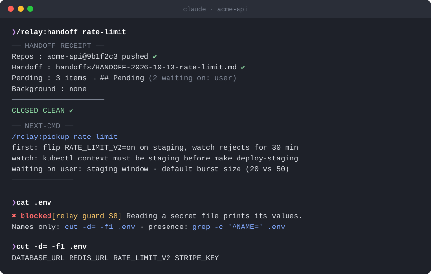

**Language:** English | [ไทย](README.th.md) <!-- leak-allow -->

# Relay

**Session handoffs, independent review, and a hook that stops secret leaks, for Claude Code.**

A small plugin for people who run more than one session: one per day, one per terminal, or one model planning while
another builds. It replaces copy-pasting between sessions with files and protocols, and it puts a hook in front of
the shell habits that leak secrets into the transcript.



[](https://github.com/porgeeratad/claude-relay/actions/workflows/ci.yml)
[](LICENSE)

-3776AB?logo=python&logoColor=white)
[](https://ko-fi.com/porgeeratad)
[](https://buymeacoffee.com/porgeeratad)

> Unofficial community plugin, not affiliated with or endorsed by Anthropic. See [Disclaimer](#disclaimer).

<table>
<tr>
<td width="50%" align="center">
  <a href="https://ko-fi.com/porgeeratad"><strong>☕ Ko-fi</strong><br /><sub>Buy the next handoff a coffee</sub></a>
</td>
<td width="50%" align="center">
  <a href="https://buymeacoffee.com/porgeeratad"><strong>🍪 Buy Me a Coffee</strong><br /><sub>Keep the guard awake</sub></a>
</td>
</tr>
</table>

---

## What's inside

| | What it does |
|---|---|
| `/relay:handoff` | Closes a session. Sweeps unfinished work, commits, and writes a handoff file with a Pending checklist. Then it prints a **receipt that never says "clean" when something failed**, plus a ready-to-paste NEXT-CMD block |
| `/relay:pickup` | Starts a session from the latest handoff. It verifies the repo against the handoff before trusting it, then continues from Pending |
| `/relay:peer` | Handshake between two live sessions over cross-session messaging. An assistant session waits instead of starting work on its own |
| `/relay:pair` | Plan → build → review between two sessions, through a thread file and a design doc with a Decision Log. A session can't review its own build |
| bash guard | A `PreToolUse` hook that blocks secret dumps (`cat .env`, `env`, raw `~/.claude.json`, …), test results swallowed by a pipe before a push, and broad `pkill -f` |

## Install

```text
/plugin marketplace add porgeeratad/claude-relay
/plugin install relay@relay
```

You need `git` and `python3` (3.8 or later; stdlib only). `/relay:peer` needs Claude Code v2.1.224 or later (v2.1.234 on native Windows); check with `/list-agents`.

## A day with relay

```text
# evening, session A
/relay:handoff rate-limit
  → receipt + NEXT-CMD:
    /relay:pickup rate-limit
    First: finish the Redis TTL test · Watch: staging uses a different key prefix

# next morning, new session
/relay:pickup rate-limit
  → reads the handoff, checks git, flags drift, proposes Pending #1
```

Two sessions at once:

```text
# terminal 1 (planner/reviewer)     # terminal 2 (builder)
/relay:pair plan rate-limit         /relay:peer builder --of <planner-name>
  → design doc + thread               /relay:pair build 2026-03-14-rate-limit.md
                                        → DONE report, rings the reviewer
/relay:pair review 2026-03-14-rate-limit.md
  → ACCEPT / REWORK with reproductions
```

## Where files go

Handoffs, pair threads and state live **outside your repository** by default, so absolute paths and session ids never end up in a commit:

```
${XDG_STATE_HOME:-~/.local/state}/claude-relay/<project-slug>/{handoffs,threads,state}
```

Every worktree of a repository shares one directory. To keep handoffs in the repo instead (for a team), add `.claude/relay.json`:

```json
{ "dir": "docs/relay", "push": "ask", "design_dir": "docs/design" }
```

| key | default | meaning |
|---|---|---|
| `dir` | outside the repo (above) | where handoffs/threads/state go; relative = from the repo root |
| `push` | `ask` | `auto` · `ask` · `never` for the push step of `/relay:handoff` |
| `design_dir` | `docs/design` | where `/relay:pair` writes design docs (these are meant to be committed) |

`RELAY_DIR` in the environment overrides `dir`. The format is specified in [docs/HANDOFF-FORMAT.md](docs/HANDOFF-FORMAT.md).

## Bash guard

Rules written in `CLAUDE.md` get broken again under pressure; a hook doesn't forget. The guard denies the command and tells Claude the safe alternative:

| id | blocks | safe alternative it suggests |
|---|---|---|
| S1 | `claude mcp list/get` | `jq '.mcpServers \| keys' ~/.claude.json` |
| S2 | raw reads of `~/.claude.json` (cat/grep/sed, scripts, jq without a field) | jq on non-secret fields |
| S3 | `/proc/<pid>/environ` dumps | names only |
| S4 | `docker inspect` without `--format` / `.Config.Env` | `--format` on one field |
| S5 | `env`, `printenv`, `docker exec … env`, `printenv *TOKEN*` | `env \| cut -d= -f1` |
| S6 | `sed 's/…/REDACTED/'` without `-n` (unmatched lines print raw) | `sed -n 's/…/…/p'` |
| S7 | `grep -v TOKEN` used as redaction | `cut -d= -f1` |
| S8 | printing `.env*`, `.envrc`, `.netrc`, `.pgpass`, `.npmrc`, credentials or private keys with cat/grep/diff/sort/awk/jq/… (`grep -c`, `cut -d= -f1`, `sed -i` stay allowed) | `cut -d= -f1 .env` |
| P1 | `pytest \| tail && git push`: the pipe hides the failure | run the tests first, or `set -o pipefail` |
| P2 | `gh run watch \| tail` | `gh run watch <id> --exit-status` |
| K1 | `pkill -f node` and other broad patterns | `kill <pid>` or a specific pattern |

Heredoc bodies and quoted text (commit messages, `echo '…'`) are ignored, so writing docs *about* these commands is fine. Output redirected to a file isn't treated as a leak. The hook fails open: an internal error never blocks you, and it's a seatbelt, not a sandbox (see [SECURITY.md](SECURITY.md)).

Configure it through the environment Claude Code runs in (for example `"env"` in `settings.json`):

- `RELAY_GUARD_OFF=S5,K1`: disable rules (`all` disables the guard)
- `RELAY_GUARD_MODE=ask`: ask instead of deny

## Principles behind it

- **A receipt that lies is worse than none.** Anything uncommitted, unpushed or failed makes the handoff `NOT CLEAN`.
- **The handoff is a claim.** Pickup verifies it against git before acting on it.
- **Messages are doorbells, files are the record.** Pair threads and design docs hold the content; `SendMessage` only says "your turn".
- **A peer is not the user.** A message from another session never counts as approval for new scope, destructive actions or spending.
- **Mechanisms over memos.** When a rule keeps getting broken, turn it into a hook or a script.

## Development

```bash
python3 tests/test_bash_guard.py && python3 tests/test_bash_guard_battery.py && python3 tests/test_relay_dir.py
scripts/leak-check.sh all && bash tests/test_leak_check.sh   # leak-check also runs pre-commit: git config core.hooksPath .githooks
claude plugin validate --strict .claude-plugin/plugin.json
```

Contributions are welcome. See [CONTRIBUTING.md](CONTRIBUTING.md): keep hooks stdlib-only, offline and fail-open,
and add a deny case and an allow case for every guard change.

## Credits

- The plugin layout follows the conventions of [everything-claude-code](https://github.com/affaan-m/everything-claude-code).
- The skills were distilled from a personal multi-session workflow, and every guard rule exists because the mistake
  it blocks actually happened.
- v0.1.0 was itself built the relay way: one session built it, a second session on a different model reviewed it
  through three rounds (173-case adversarial battery included).

## Support

If relay saves you a re-explained context or a leaked token, you can support it:

- ☕ [ko-fi.com/porgeeratad](https://ko-fi.com/porgeeratad)
- 🍪 [buymeacoffee.com/porgeeratad](https://buymeacoffee.com/porgeeratad)

Stars, bug reports, new guard cases and pull requests help too.

## Disclaimer

Relay is an unofficial community plugin. It is not affiliated with, endorsed by, or supported by Anthropic. Claude
and Claude Code are trademarks of Anthropic, PBC. The bash guard is a seatbelt, not a sandbox: it catches common
accidents, not a determined attacker. Use Claude Code's permission rules and sandboxing for hard boundaries.

## License

[MIT](LICENSE).
